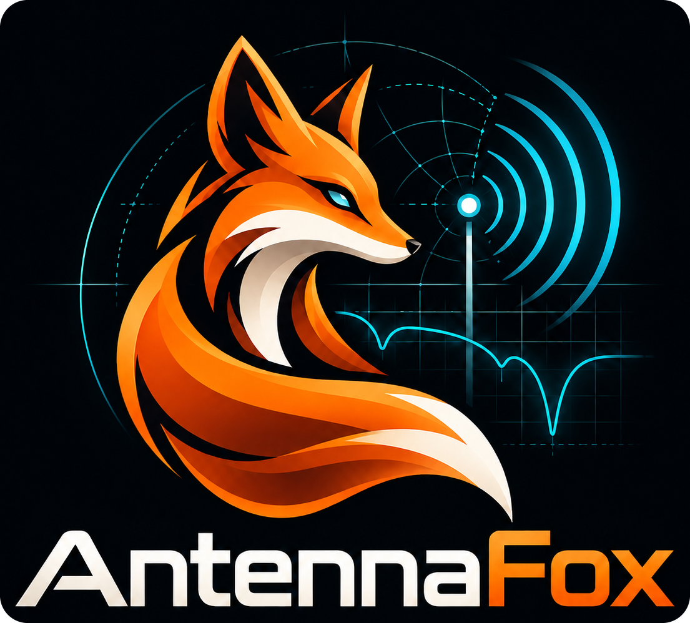
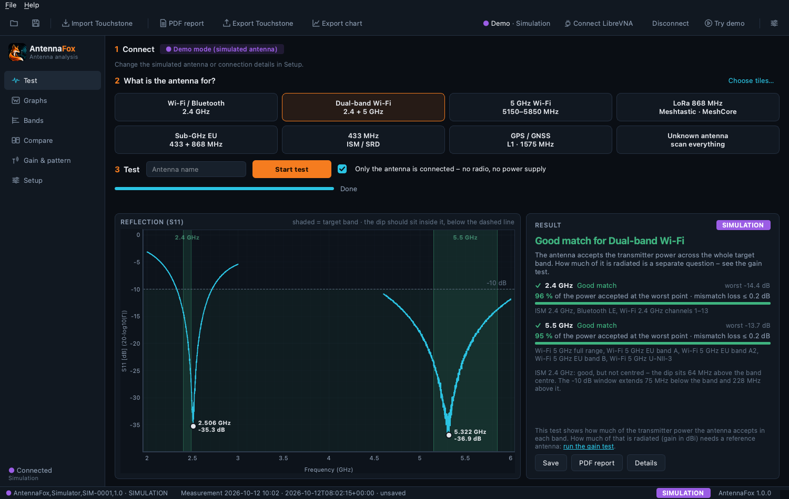
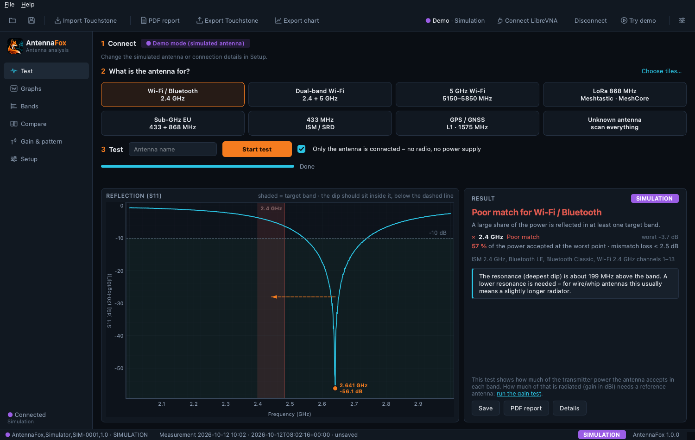
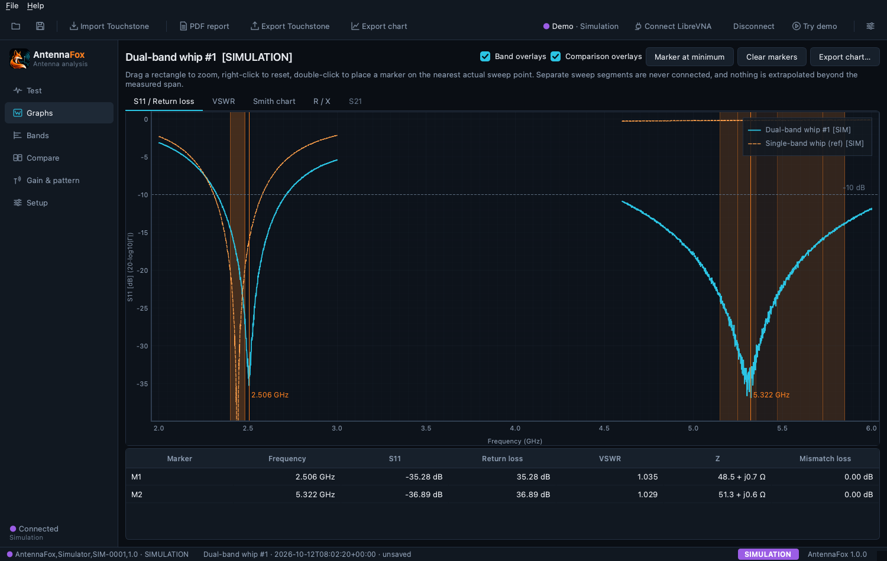
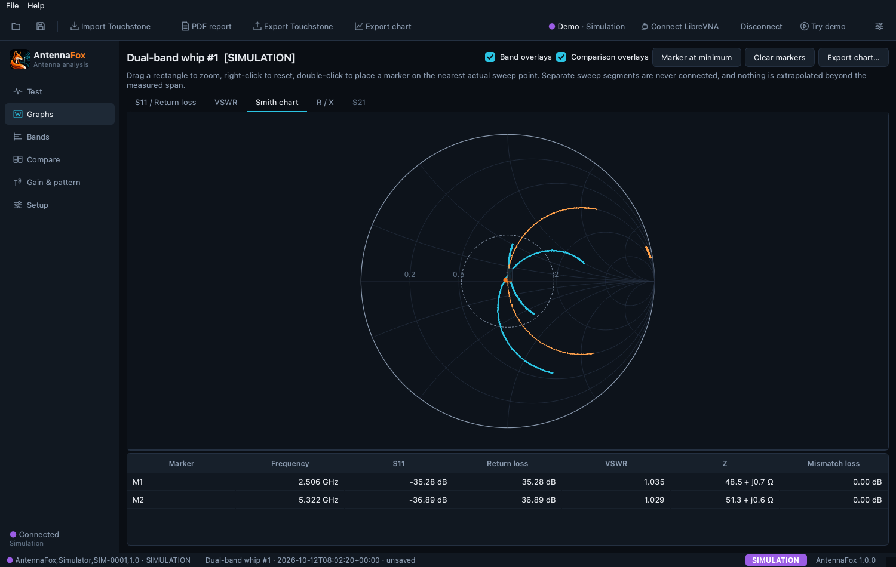
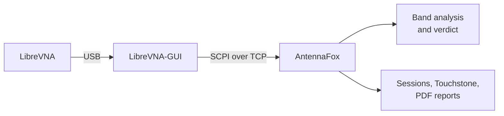

<div align="center">



### Antenna Analysis GUI for Vector Network Analyzers

Test antennas in a few clicks: see where the resonance sits, whether it covers your band,<br>
and what to change – with measurements that never claim more than they show. Works with [LibreVNA](https://github.com/jankae/LibreVNA).

[](https://github.com/AltinumTechnologies/antennafox/actions/workflows/tests.yml)
[](LICENSE)
[](pyproject.toml)
[](https://doc.qt.io/qtforpython-6/)
[](https://github.com/jankae/LibreVNA)
[](docs/GETTING_STARTED.md#requirements)

[**Features**](#features) · [**Install**](#install) · [**First test**](#first-test) · [**Docs**](#documentation) · [**Contributing**](#contributing)

</div>

<br>

<p align="center">
  
  <br>
  <sub>Test page with a simulated dual-band antenna (demo mode). Both target bands are shaded green, the resonances are marked.</sub>
</p>

## Features

| | |
|---|---|
| **Guided antenna test**<br>Pick what the antenna is for – Wi-Fi, BLE, LoRa 868, 433 MHz, GNSS, or your own saved preset – and start. Presets choose span and sample density for you. | **Visual verdict**<br>Target bands are shaded green, amber or red. The resonance is marked, and an arrow shows where it has to move when it misses the band. |
| **Band suitability**<br>Each band is judged by its worst point over the full required range – including regional Wi-Fi sub-bands, EU SRD sub-bands and Meshtastic/MeshCore channels. Partially measured bands are reported as such. | **Engineering views**<br>S11/return loss, VSWR, Smith chart, R/X and S21 with markers on actual sweep points and before/after overlays. |
| **Reliable LibreVNA control**<br>Talks to the official LibreVNA-GUI over SCPI. Every setting is read back, sweeps run in the background and can be cancelled, and incomplete or stale traces are rejected. | **Data you can keep**<br>Lossless `.afox` sessions with provenance, Touchstone `.s1p`/`.s2p` import and export, CSV/JSON, chart images and a PDF report. |
| **Comparisons**<br>Line up antennas, cables or enclosure variants per band – without a misleading single "best" ranking. | **Gain, done carefully**<br>A guided comparative S21 test estimates directional realized gain only against a characterized reference antenna, with an uncertainty budget. |

> [!IMPORTANT]
> An S11 test characterizes **impedance match** – how much power the antenna accepts at its connector. It does not
> measure gain, radiation efficiency, radiation pattern or range: a lossy antenna can be perfectly matched.
> AntennaFox reports *Gain: not measured* for S11 tests and warns when a match looks suspiciously broadband.
> Details: [measurement method](docs/MEASUREMENT_METHOD.md).

<table>
  <tr>
    <td width="33%"></td>
    <td width="33%"></td>
    <td width="33%"></td>
  </tr>
  <tr>
    <td align="center"><sub>Detuned antenna: resonance 200 MHz too high</sub></td>
    <td align="center"><sub>S11 with comparison overlay and readout</sub></td>
    <td align="center"><sub>Smith chart</sub></td>
  </tr>
</table>
<p align="center"><sub>Screenshots use simulated antennas in demo mode.</sub></p>

## Install

Requires Python 3.11+ and, for measurements, a [LibreVNA](https://github.com/jankae/LibreVNA) with the official
LibreVNA-GUI. Tested on macOS; Linux and Windows are included in the CI test matrix but have not been verified with hardware.

```bash
git clone https://github.com/AltinumTechnologies/antennafox.git
cd antennafox
uv sync            # or: python3 -m venv .venv && . .venv/bin/activate && pip install .
uv run antennafox  # or: antennafox
```

The packaging workflow builds an unsigned macOS app bundle for each tagged release; it can also be built from
source – see [packaging](docs/PACKAGING.md). Unsigned builds must be opened via right-click → *Open* the first time.

## First test

1. Start **LibreVNA-GUI** with the device attached and enable its SCPI server
   (*Window → Preferences → General → SCPI Server*, port 19542). For accurate values,
   [calibrate port 1](docs/CALIBRATION.md) in LibreVNA-GUI first.
2. In AntennaFox, click **Connect LibreVNA** – or **Try demo** to explore without hardware.
3. Choose what the antenna is for, attach only the antenna, and click **Start test**.

The [getting started guide](docs/GETTING_STARTED.md) explains the result view and troubleshooting.

## How it works



AntennaFox never opens the USB device. It drives the official LibreVNA-GUI through its documented SCPI interface,
so device control and calibration stay where they belong. AntennaFox adds the antenna-specific workflow on top:
sweep planning, band evaluation, visualization and reporting.

## Documentation

| | |
|---|---|
| [Getting started](docs/GETTING_STARTED.md) | Install, connect, first measurement, troubleshooting |
| [Calibration](docs/CALIBRATION.md) | Calibrating in LibreVNA-GUI and how AntennaFox tracks it |
| [Measurement method](docs/MEASUREMENT_METHOD.md) | RF formulas, band qualification, gain estimation and limits |
| [LibreVNA integration](docs/LIBREVNA_INTEGRATION.md) | SCPI details, synchronization, version notes |
| [Session file format](docs/FILE_FORMAT.md) | The `.afox` bundle |
| [Hardware validation](docs/HARDWARE_VALIDATION.md) | Manual checks with real hardware and their status |
| [Architecture](docs/ARCHITECTURE.md) | Code structure and development commands |
| [Device adapters](docs/DEVICE_ADAPTERS.md) | Instrument interface, shared measurement model, how to add a VNA adapter |
| [Test quality](docs/TEST_QUALITY.md) | Coverage, reference-value and mutation-testing review |
| [Licensing audit](docs/LICENSING_AUDIT.md) | Dependency licenses, Qt/LGPL compliance, packaging obligations |
| [Changelog](CHANGELOG.md) | Release history |

## Supported instruments

| Instrument | Status |
|---|---|
| [LibreVNA](https://github.com/jankae/LibreVNA) (V1, via LibreVNA-GUI 1.6.5 SCPI server) | **Supported** – validated on hardware, see [hardware validation](docs/HARDWARE_VALIDATION.md) |
| NanoVNA-H / H4 | Planned – not started |
| LiteVNA 64 | Planned – not started |

AntennaFox talks to instruments through a small adapter interface, and everything above that layer – analysis,
plots, sessions, reports – is device-independent. The planned devices have no timeline; adding one means writing an
adapter as described in [device adapters](docs/DEVICE_ADAPTERS.md), and contributions are welcome. Measurements
from any VNA can already be analysed by importing their Touchstone files.

## LibreVNA integration

AntennaFox exists because of [LibreVNA](https://github.com/jankae/LibreVNA), the open-source 100 kHz – 6 GHz
vector network analyzer by Jan Käberich and contributors. Their hardware, firmware and LibreVNA-GUI – including the
SCPI interface AntennaFox builds on – make affordable antenna measurements possible.

AntennaFox is an independent open-source project and is not officially affiliated with or endorsed by the LibreVNA
developers.

## Contributing

Bug reports, measurement feedback and pull requests are welcome:

- **Report a bug** or **suggest a feature** via [issues](https://github.com/AltinumTechnologies/antennafox/issues/new/choose)
- **Improve the docs** or **submit code** – see [CONTRIBUTING.md](CONTRIBUTING.md)
- **Security issues** – see [SECURITY.md](SECURITY.md)

## License

AntennaFox is free software: you can redistribute it and/or modify it under the terms of the
[GNU General Public License](LICENSE), version 3 or (at your option) any later version. © 2026
Altinum Technologies e.U. ([altinum.tech](https://altinum.tech)). It is distributed WITHOUT ANY WARRANTY. The copyright
notice and the trademark declination (GPL §7(e)) are in [NOTICE](NOTICE).

Modified versions must be released under the same license with their source code; commercial use and
redistribution are permitted on those terms. Third-party components keep their own licenses, including Qt and
Qt for Python (PySide6) under the LGPL-3.0 with replaceable libraries in binary bundles – see
[THIRD_PARTY_NOTICES.md](THIRD_PARTY_NOTICES.md) and [LICENSES/](LICENSES/). The AntennaFox name, the fox logo and
"Altinum Technologies" are not covered by the software license; see [TRADEMARKS.md](TRADEMARKS.md).
