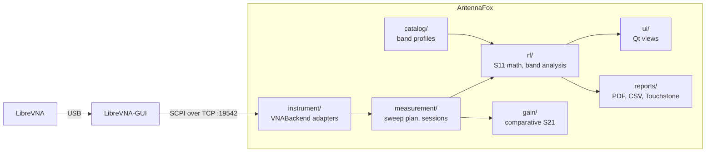

# Architecture

AntennaFox is a Python/PySide6 desktop application. Instrument access goes through a small adapter interface
(`VNABackend`); the LibreVNA adapter never talks to the USB device directly but to LibreVNA-GUI's SCPI server over
TCP. Everything after the adapter boundary is device-independent.



## Packages

| Package | Responsibility |
|---|---|
| `src/antennafox/__main__.py`, `diagnostics.py` | Entry point (`antennafox`, `--verbose`, `--debug`), log file with ring buffer and the diagnostics bundle |
| `src/antennafox/instrument/` | `base.py`: `VNABackend` adapter contract, device capabilities, errors; `adapters.py`: registry of live adapters. One sub-package per implementation: `librevna/` (`backend.py` SCPI adapter, `scpi_transport.py`, `emulator.py` emulated LibreVNA-GUI for tests) and `simulated/` (`backend.py` demo backend, `models.py` synthetic antenna models) |
| `src/antennafox/measurement/` | Data model (immutable traces with provenance), sweep presets and orchestration, `.afox` session bundles |
| `src/antennafox/rf/` | Pure functions: reflection math, band coverage and qualification, data quality checks, Touchstone, plain-language summaries |
| `src/antennafox/catalog/` | Versioned JSON catalog (`catalog/data/bands.json`) of frequency bands and protocol channels, plus optional user bands |
| `src/antennafox/gain/` | Substitution-method gain estimate and directional cuts from S21 captures |
| `src/antennafox/reports/` | CSV, JSON and Touchstone export, matplotlib charts, PDF report |
| `src/antennafox/ui/` | Qt views (`quick_page`, `graphs_page`, `bands_page`, `compare_page`, the `setup/` and `gain/` packages), `state.py` (application state and settings), `plots.py` (pyqtgraph), `theme.py`, `icons.py`, background worker for acquisition |

## Design rules

- **Raw data first.** Captured traces are immutable complex values. Every derived value (VSWR, band verdicts,
  gain estimates) is recomputed from them.
- **No silent changes.** Settings sent to the instrument are read back. Frequencies outside the instrument range
  are clamped before a sweep and the clamping is disclosed.
- **Background acquisition.** Sweeps run in a worker thread, are cancellable and use timeouts scaled to points,
  IF bandwidth and averaging.
- **Honest scope.** S11-only results never report gain. Absolute gain requires a valid comparative measurement
  against a characterized reference.
- **Device-specific code stays in its adapter.** Command sets, response parsing and protocol quirks live in one
  module per device; the measurement model, RF math, reports and views only see `InstrumentInfo`, `TraceSegment`
  and `DeviceCapabilities`. See [device adapters](DEVICE_ADAPTERS.md) for the contract and extension points.

Further reading: [device adapters](DEVICE_ADAPTERS.md), [LibreVNA integration](LIBREVNA_INTEGRATION.md),
[measurement method](MEASUREMENT_METHOD.md), [session file format](FILE_FORMAT.md).

## Development

```bash
uv sync
QT_QPA_PLATFORM=offscreen uv run pytest --cov   # all tests, no hardware required; CI fails below 85 % (--cov-fail-under=85)
uv run ruff check src tests          # lint
uv run pyright                       # types
uv run python -m antennafox.instrument.librevna.emulator --port 19542   # emulated LibreVNA-GUI
```

CI (`.github/workflows/tests.yml`) runs ruff, pyright and the suite on Linux, macOS and Windows with Python 3.11 and
3.12 plus an ARM Linux runner, with `uv sync --locked`, a 180 s per-test timeout and the coverage gate; `reuse lint`
verifies the SPDX metadata. Packaging lives in `packaging/` and `scripts/bundle_inventory.py`, see
[packaging](PACKAGING.md).

The emulated server reproduces LibreVNA-GUI 1.6.5 SCPI behavior (silent errors, single-sweep semantics, trace
format) and supports fault injection. Its data is marked as simulated.
